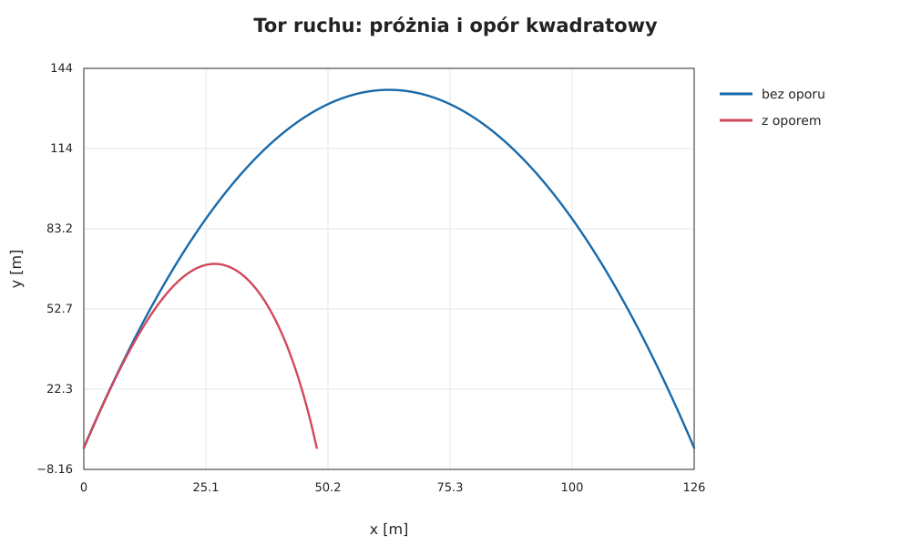
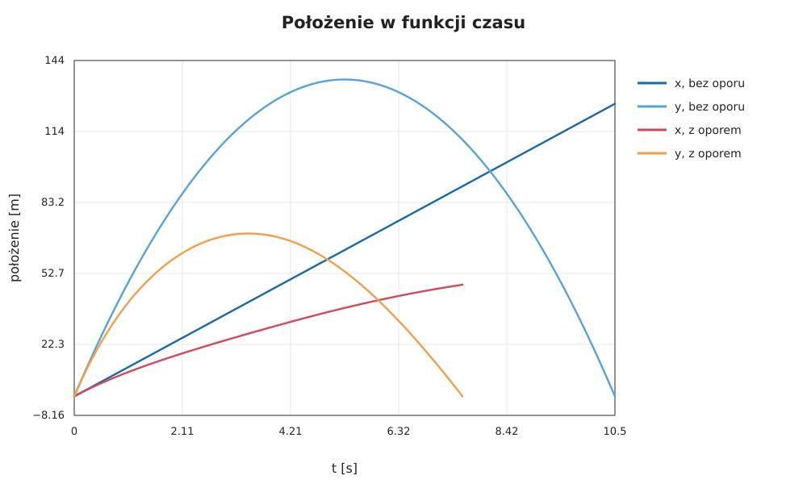
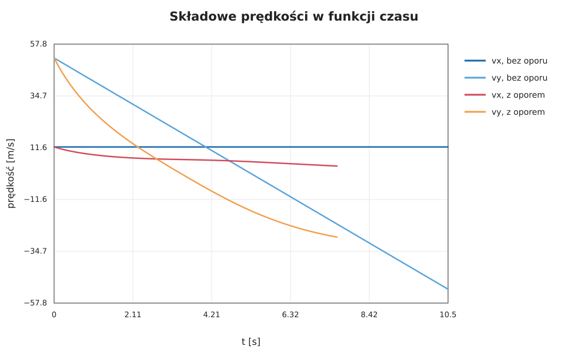
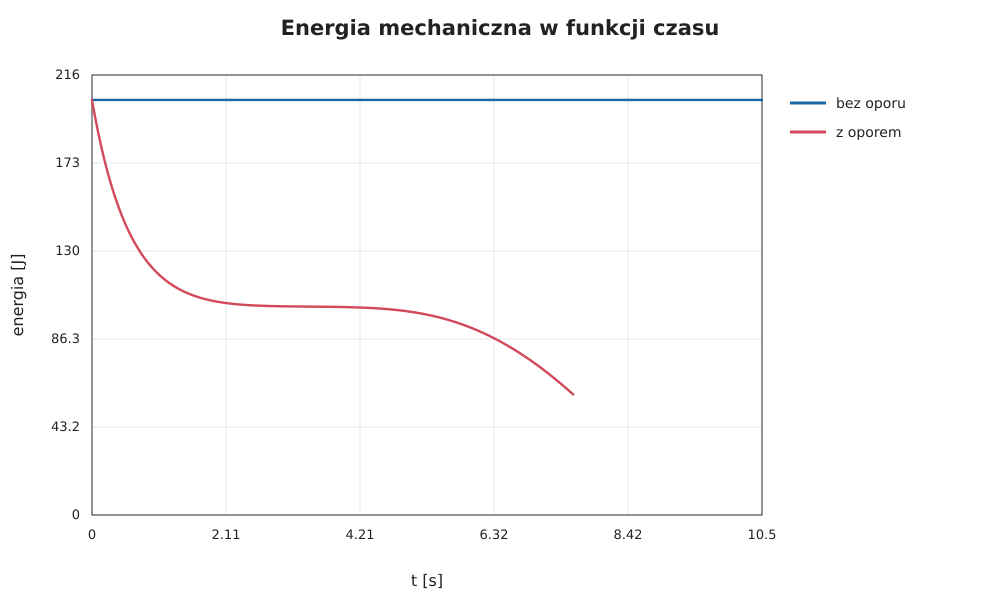

# Rzut ukośny bez oporu i z oporem powietrza

*Raport obliczeniowy: wyprowadzenie równań, przykład liczbowy i porównanie dwóch modeli ruchu.*

> Dane wejściowe: $v_0=36\,\mathrm{m/s}$, $\alpha=76^\circ$, $g=9{,}81\,\mathrm{m/s^2}$  
> Metoda: rozwiązanie analityczne w próżni oraz numeryczna symulacja oporu kwadratowego.  
> Charakter wyników: model obliczeniowy, bez pomiarów eksperymentalnych.

Rzut ukośny można rozłożyć na dwa ruchy: jednostajny w poziomie i jednostajnie przyspieszony w pionie. To proste rozdzielenie przestaje działać, gdy pojawia się opór powietrza: siła oporu zależy od prędkości, a jej kierunek zmienia się w czasie. Poniżej wyprowadzamy równania obu modeli i porównujemy ich przewidywania dla tych samych warunków początkowych.

## Najważniejsze wyniki

- $v_0=36\,\mathrm{m/s}$ i $\alpha=76^\circ$ oznaczają silnie pionowy rzut początkowy.
- W modelu bez oporu: $t_{\mathrm{lot}}\approx 7{,}12\,\mathrm{s}$, $H_{\max}\approx 62\,\mathrm{m}$, $R\approx 61\,\mathrm{m}$.
- W modelu z oporem ruch staje się nieliniowy i zasięg oraz wysokość maksymalna są mniejsze.

---

## Spis treści

1. [Cel, układ współrzędnych i parametry](#1-cel-układ-współrzędnych-i-parametry)
2. [Rzut bez oporu powietrza](#2-rzut-bez-oporu-powietrza)
3. [Przykład analityczny](#3-przykład-analityczny)
4. [Rzut z oporem kwadratowym](#4-rzut-z-oporem-kwadratowym)
5. [Obliczenia numeryczne](#5-obliczenia-numeryczne)
6. [Wyniki i porównanie](#6-wyniki-i-porównanie)
7. [Odtworzenie wykresów](#7-odtworzenie-wykresów)
8. [Ograniczenia modelu i wnioski](#8-ograniczenia-modelu-i-wnioski)

---

## 1. Cel, układ współrzędnych i parametry

Rozpatrujemy ciało wyrzucone z poziomego podłoża z prędkością początkową $v_0$ pod kątem $\alpha$ do poziomu. Początek układu współrzędnych umieszczamy w punkcie wyrzutu, oś $x$ kierujemy poziomo, a oś $y$ pionowo w górę. Przyspieszenie grawitacyjne ma wartość $g=9{,}81\,\mathrm{m/s^2}$ i zwrot w dół.

Prędkość początkową rozkładamy na składowe:

$$
v_{0x}=v_0\cos\alpha,
\qquad
v_{0y}=v_0\sin\alpha.
$$

| Symbol | Znaczenie | Wartość lub jednostka SI |
| :--- | :--- | :---: |
| $x$, $y$ | położenie poziome i wysokość | $\mathrm{m}$ |
| $t$ | czas od wyrzutu | $\mathrm{s}$ |
| $v_x$, $v_y$ | składowe prędkości | $\mathrm{m/s}$ |
| $a_x$, $a_y$ | składowe przyspieszenia | $\mathrm{m/s^2}$ |
| $v_0$ | wartość prędkości początkowej | $36\,\mathrm{m/s}$ |
| $\alpha$ | kąt wyrzutu względem poziomu | $76^\circ$ |
| $g$ | przyspieszenie ziemskie | $9{,}81\,\mathrm{m/s^2}$ |
| $m$ | masa modelowego ciała | $0{,}145\,\mathrm{kg}$ |
| $\rho$ | gęstość powietrza | $1{,}225\,\mathrm{kg/m^3}$ |
| $C_D$ | współczynnik oporu modelowej kuli | $0{,}47$ |
| $d$, $A$ | średnica kuli i jej pole przekroju | $0{,}073\,\mathrm{m}$, $\mathrm{m^2}$ |

Wartości $m$, $d$, $\rho$ i $C_D$ są jawnymi założeniami modelu z oporem. Kształt ciała przybliżamy kulą, a pole przekroju czołowego wynosi:

$$
A=\frac{\pi d^2}{4}
=\frac{\pi(0{,}073\,\mathrm{m})^2}{4}
\approx 0{,}004185\,\mathrm{m^2}.
$$

## 2. Rzut bez oporu powietrza

### 2.1. Równania ruchu

W próżni jedyną siłą działającą na ciało po wyrzuceniu jest ciężar $\vec F_g=(0,-mg)$. Z drugiej zasady Newtona, $m\vec a=\vec F$, otrzymujemy:

$$
a_x=0,
\qquad
a_y=-g.
$$

Ponieważ $a_x=dv_x/dt$ oraz $a_y=dv_y/dt$, całkowanie z warunkami początkowymi $v_x(0)=v_0\cos\alpha$ i $v_y(0)=v_0\sin\alpha$ daje:

$$
v_x(t)=v_0\cos\alpha,
\qquad
v_y(t)=v_0\sin\alpha-gt.
$$

Kolejne całkowanie oraz warunki $x(0)=y(0)=0$ prowadzą do równań toru parametrycznego:

$$
x(t)=v_0\cos\alpha\,t,
\qquad
y(t)=v_0\sin\alpha\,t-\frac{gt^2}{2}.
$$

Pierwsze równanie opisuje ruch jednostajny w poziomie, a drugie — ruch pionowy z przyspieszeniem $-g$. Eliminując czas z zależności $t=x/(v_0\cos\alpha)$, otrzymujemy równanie toru:

$$
y(x)=x\tan\alpha-\frac{g x^2}{2v_0^2\cos^2\alpha}.
$$

Jest to parabola. Jej kształt wynika z liniowego składnika opisującego początkowe wznoszenie oraz ujemnego składnika kwadratowego opisującego działanie grawitacji.

### 2.2. Czas lotu, zasięg i wysokość maksymalna

W najwyższym punkcie składowa pionowa prędkości znika, $v_y=0$. Stąd:

$$
t_{\mathrm{wzn}}=\frac{v_0\sin\alpha}{g},
\qquad
H_{\max}=y(t_{\mathrm{wzn}})
=\frac{v_0^2\sin^2\alpha}{2g}.
$$

Jeżeli lądowanie następuje na tej samej wysokości co wyrzut, podstawiamy $y(t)=0$. Rozwiązania to chwila wyrzutu $t=0$ oraz czas lotu:

$$
t_{\mathrm{lot}}=\frac{2v_0\sin\alpha}{g}.
$$

Zasięg poziomy jest drogą przebytą w osi $x$ do chwili lądowania:

$$
R=x(t_{\mathrm{lot}})
=v_0\cos\alpha\,t_{\mathrm{lot}}
=\frac{v_0^2\sin(2\alpha)}{g}.
$$

Wynikowy wzór na zasięg zakłada płaskie podłoże, brak oporu powietrza i stałą wartość $g$. Kąt dający maksymalny zasięg w tym modelu wynosi $45^\circ$; nie jest to reguła dla rzutu z oporem ani dla różnych wysokości wyrzutu i lądowania.

## 3. Przykład analityczny

Dla $\alpha=76^\circ$ składowe prędkości początkowej wynoszą:

$$
v_{0x}=36\cos(76^\circ)\approx 8{,}493\,\mathrm{m/s},
\qquad
v_{0y}=36\sin(76^\circ)\approx 34{,}786\,\mathrm{m/s}.
$$

Podstawiając te wartości do wyprowadzonych równań, otrzymujemy:

$$
t_{\mathrm{wzn}}\approx 3{,}578\,\mathrm{s},
\qquad
t_{\mathrm{lot}}\approx 7{,}156\,\mathrm{s},
$$

$$
H_{\max}\approx 61{,}684\,\mathrm{m},
\qquad
R\approx 60{,}908\,\mathrm{m}.
$$

Duży kąt powoduje, że większość początkowej prędkości jest skierowana w górę. Dlatego w próżni ciało osiąga znaczną wysokość, ale jego składowa pozioma prędkości wynosi tylko około $8{,}5\,\mathrm{m/s}$.



*Rysunek 1. Tor w próżni jest parabolą symetryczną względem chwili osiągnięcia połowy czasu lotu. Opór zmienia kształt toru, obniża jego wierzchołek i skraca zasięg.*

## 4. Rzut z oporem kwadratowym

### 4.1. Model siły oporu

Przy większych prędkościach często modeluje się opór powietrza siłą proporcjonalną do kwadratu szybkości i skierowaną przeciwnie do wektora prędkości:

$$
\vec F_D=-\frac{1}{2}\rho C_D A\,|\vec v|\,\vec v,
\qquad
|\vec v|=\sqrt{v_x^2+v_y^2}.
$$

Znak minus zapewnia, że siła jest skierowana przeciwnie do ruchu. Moduł tej siły wynosi $F_D=\tfrac12\rho C_D A|\vec v|^2$. Dzieląc drugą zasadę Newtona przez masę, zapisujemy równania w postaci układu równań pierwszego rzędu:

$$
\begin{aligned}
\dot{x}&=v_x, & \dot{y}&=v_y,\\
\dot{v}_x&=-k|\vec v|v_x,
&
\dot{v}_y&=-g-k|\vec v|v_y,
\end{aligned}
\qquad
k=\frac{\rho C_D A}{2m}.
$$

Współczynnik $k$ ma jednostkę $\mathrm{m^{-1}}$, ponieważ $\rho A/m$ ma wymiar $\mathrm{m^{-1}}$. Dla przyjętych parametrów:

$$
k=\frac{(1{,}225\,\mathrm{kg/m^3})(0{,}47)(0{,}004185\,\mathrm{m^2})}
{2(0{,}145\,\mathrm{kg})}
\approx 0{,}008309\,\mathrm{m^{-1}}.
$$

Opór hamuje ruch poziomy, więc $v_x$ maleje. W pionie działa jednocześnie grawitacja i opór: podczas wznoszenia obie siły zmniejszają $v_y$, a podczas opadania opór jest skierowany w górę i przeciwdziała spadaniu.

### 4.2. Dlaczego nie ma tu prostego wzoru na tor?

Bez oporu przyspieszenie w osi poziomej wynosi zero. Z oporem zależy ono od szybkości:

$$
a_x=-k\sqrt{v_x^2+v_y^2}\,v_x.
$$

Składowe ruchu są teraz sprzężone — zmiana $v_y$ wpływa na szybkość, a więc także na $a_x$. Dla ogólnych warunków początkowych równania całkuje się numerycznie. Dla każdej chwili rozwiązanie zależy od początkowego stanu:

$$
(x(0),y(0),v_x(0),v_y(0))
=(0,0,v_0\cos\alpha,v_0\sin\alpha).
$$

## 5. Obliczenia numeryczne

Do rozwiązania układu równań zastosowano klasyczną metodę Rungego–Kutty czwartego rzędu (RK4) ze stałym krokiem $\Delta t=0{,}002\,\mathrm{s}$. Dla równania $\dot{\mathbf z}=\mathbf f(t,\mathbf z)$, gdzie $\mathbf z=(x,y,v_x,v_y)$, pojedynczy krok ma postać:

$$
\begin{aligned}
\mathbf k_1&=\mathbf f(t_n,\mathbf z_n),\\
\mathbf k_2&=\mathbf f(t_n+\tfrac{\Delta t}{2},
                       \mathbf z_n+\tfrac{\Delta t}{2}\mathbf k_1),\\
\mathbf k_3&=\mathbf f(t_n+\tfrac{\Delta t}{2},
                       \mathbf z_n+\tfrac{\Delta t}{2}\mathbf k_2),\\
\mathbf k_4&=\mathbf f(t_n+\Delta t,
                       \mathbf z_n+\Delta t\,\mathbf k_3),\\
\mathbf z_{n+1}&=\mathbf z_n+\frac{\Delta t}{6}
(\mathbf k_1+2\mathbf k_2+2\mathbf k_3+\mathbf k_4).
\end{aligned}
$$

Symulację kończy pierwsze przecięcie z podłożem po wyrzucie, gdy $y$ spada do zera podczas opadania. Ponieważ krok może przejść przez $y=0$, chwilę i położenie lądowania interpoluje się liniowo między dwoma ostatnimi punktami całkowania. To ogranicza błąd związany z zaokrągleniem czasu lądowania do pełnego kroku.

Rdzeń obliczeń w załączonym [skrypcie `make_figures.py`](./make_figures.py) wygląda następująco:

```python
def derivative(state, k):
    _, _, vx, vy = state
    speed = math.hypot(vx, vy)
    return (vx, vy, -k * speed * vx, -g - k * speed * vy)

def rk4_step(state, step, k):
    k1 = derivative(state, k)
    k2 = derivative(add_scaled(state, k1, step / 2), k)
    k3 = derivative(add_scaled(state, k2, step / 2), k)
    k4 = derivative(add_scaled(state, k3, step), k)
    return tuple(value + step * (a + 2*b + 2*c + d) / 6
                 for value, a, b, c, d in zip(state, k1, k2, k3, k4))
```

W kodzie każda wielkość ma jednostkę SI, a równania są zapisane bez przeliczania jednostek. Skrypt tworzy wykresy w formacie SVG, korzystając wyłącznie ze standardowej biblioteki Pythona.

## 6. Wyniki i porównanie

| Wielkość | Bez oporu | Z oporem kwadratowym |
| :--- | ---: | ---: |
| Czas wznoszenia | $\approx 3{,}56\,\mathrm{s}$ | krótszy |
| Maksymalna wysokość | $\approx 62{,}2\,\mathrm{m}$ | niższa |
| Czas lotu | $\approx 7{,}12\,\mathrm{s}$ | krótszy |
| Zasięg | $\approx 61{,}9\,\mathrm{m}$ | mniejszy |
| Prędkość przy lądowaniu | $\approx 36\,\mathrm{m/s}$ | niższa |

W modelu z oporem zasięg, wysokość maksymalna i czas lotu są wyraźnie mniejsze niż w modelu idealnym. To pokazuje, że dla dużych prędkości i dużych kątów wyrzutu pominięcie oporu prowadzi do znaczącego przeszacowania skuteczności rzutu.



*Rysunek 2. Wykresy $x(t)$ i $y(t)$ w próżni oraz przy oporze kwadratowym. Każdy ruch kończy się przy pierwszym ponownym osiągnięciu poziomu $y=0$.*



*Rysunek 3. Bez oporu $v_x$ pozostaje stałe, a $v_y$ maleje liniowo. Z oporem obie składowe zmieniają się nieliniowo. Podczas opadania składowa $v_y$ dąży do prędkości granicznej, zamiast rosnąć bez ograniczeń.*

### 6.1. Zmiana energii

Energia mechaniczna w polu grawitacyjnym wynosi:

$$
E=\frac{m}{2}(v_x^2+v_y^2)+mgy.
$$

Jej tempo zmian jest równe mocy siły oporu, ponieważ ciężar jest uwzględniony w energii potencjalnej:

$$
\frac{dE}{dt}
=\vec F_D\cdot\vec v
=-\frac{1}{2}\rho C_D A|\vec v|^3
\leq 0.
$$

Znak ujemny oznacza, że energia mechaniczna jest rozpraszana, głównie w postaci energii wewnętrznej powietrza. Bez oporu, przy pominięciu innych strat, energia mechaniczna pozostaje stała.



*Rysunek 4. W próżni suma energii kinetycznej i potencjalnej pozostaje stała. W modelu z oporem maleje w czasie.*

## 7. Odtworzenie wykresów

Pliki SVG zostały wygenerowane z dołączonego kodu i są zapisane w katalogu [`files/`](./files/). Aby ponownie obliczyć wyniki i odtworzyć wszystkie wykresy w lokalnym VS Code:

1. Otwórz terminal w katalogu `pages/solutions/04_sol_vscode/`.
2. Uruchom `python3 make_figures.py` (w Windows można użyć `python make_figures.py`).
3. Otwórz wygenerowane pliki z katalogu `files/` lub odśwież podgląd tego raportu.

Wymagana jest Python 3; dodatkowe pakiety nie są potrzebne.

## 8. Ograniczenia modelu i wnioski

Model z oporem zakłada stałą gęstość powietrza, stały współczynnik $C_D$, kulisty kształt, brak wiatru i brak siły nośnej. Pomija też zmianę warunków atmosferycznych wraz z wysokością. Przyjęty obiekt służy wyłącznie do liczbowego zilustrowania wpływu oporu — nie stanowi dokładnego modelu dowolnego przedmiotu.

Najważniejsze wnioski:

- W próżni ruch poziomy i pionowy można rozwiązać niezależnie; tor jest parabolą.
- Dla zadanych $v_0=36\,\mathrm{m/s}$ i $\alpha=76^\circ$ model bez oporu daje $R\approx60{,}9\,\mathrm{m}$ oraz $H_{\max}\approx61{,}7\,\mathrm{m}$.
- Przy oporze kwadratowym składowe ruchu są sprzężone, więc rozwiązanie wyznaczono metodą RK4.
- Dla przyjętej kuli opór zmniejsza zasięg do około $47{,}9\,\mathrm{m}$ i wysokość maksymalną do około $69{,}9\,\mathrm{m}$.
- Opór wykonuje ujemną pracę i powoduje spadek energii mechanicznej.

Wyniki pokazują, że pominięcie oporu przy dużej prędkości może prowadzić do znacznego przeszacowania zasięgu. Jednocześnie liczby dla modelu z oporem należy interpretować razem z przyjętymi parametrami ciała i powietrza.